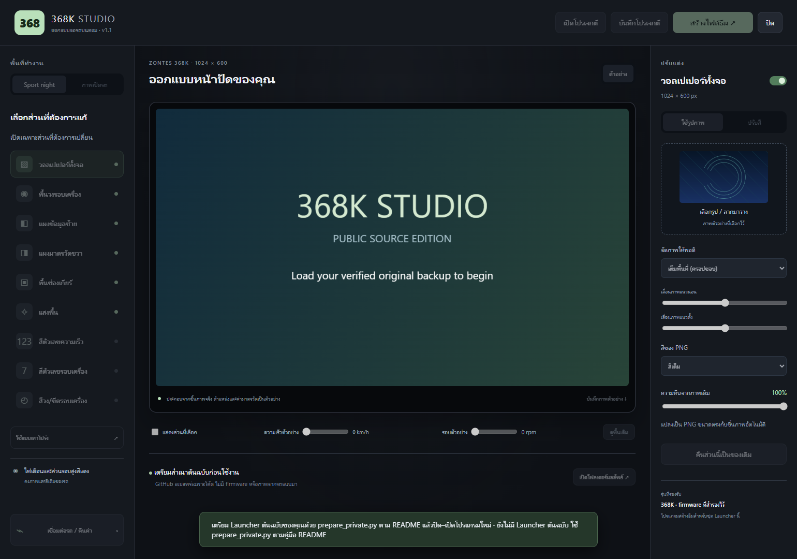

# 368K Studio

โปรแกรม Windows สำหรับออกแบบธีม **Sport แบบกลางคืนของ ZONTES 368K** บนคอม แปลงรูป ตรวจไฟล์ Launcher แล้วติดตั้งหรือคืนค่าผ่าน Wi-Fi รถ มี UI ภาษาไทยและตัวอย่างหน้าปัด 1024 × 600

**รองรับเฉพาะ firmware ที่ SHA-256 ตรงกับชุดที่ระบุด้านล่าง** ชื่อรุ่น 368K เหมือนกันไม่ได้หมายความว่า firmware ตรงกัน โปรแกรมเป็นงานทดลองของผู้ใช้ ไม่ได้เป็นผลิตภัณฑ์หรือเครื่องมืออย่างเป็นทางการของผู้ผลิตรถ

Repository นี้เผยแพร่ **โค้ด คู่มือ และภาพตัวอย่างทรงเรขาคณิตที่สร้างใหม่** สำเนา Launcher, boot partition, ภาพ/ฟอนต์ที่ดึงจากรถ และรูปส่วนตัวของผู้ใช้ต้องอยู่บนคอมของผู้ใช้เอง ไม่ได้แนบใน GitHub หรือ EXE ที่ build จาก repository นี้



## โปรแกรมทำอะไรได้บ้าง

| ส่วน | การปรับที่รองรับ |
| --- | --- |
| วอลเปเปอร์ | นำเข้า PNG/JPG/GIF/WEBP/BMP, ครอป/ย่อ/ขยาย, เลื่อนจุดครอป, ลดจำนวนสี |
| พื้นวงรอบเครื่อง | เปลี่ยนสีหรือใส่ภาพ และปรับความโปร่ง |
| แผงข้อมูลซ้าย / แผงมาตรวัดขวา | เปลี่ยนสีหรือภาพ โดยคงรูปทรง alpha ของชิ้นภาพเดิม |
| พื้นช่องเกียร์ / แสงพื้น | เปลี่ยนสีหรือภาพ และปรับความโปร่ง |
| ตัวเลขความเร็ว | ปรับสีด้วยชุดสี 24 สี, HEX หรือ RGB |
| ตัวเลขรอบเครื่อง 0–7 | ปรับสี โดยคงรูปทรงและความทึบเดิม |
| วง/ขีด/แถบรอบเครื่อง | ปรับสี โดยคงพิกเซลเขตรอบสูงสีแดง |
| แอนิเมชันเปิดรถ | แปลง GIF และส่งออก boot image บนคอม; ยังไม่มีปุ่มเขียนพาร์ทิชันบูต |

แถบความเร็ว/รอบเครื่องในตัวอย่างใช้จำลองค่าบนคอม ไม่ส่งค่าความเร็วหรือรอบเครื่องไปที่รถ ภาพ preview เป็นการประกอบชิ้นภาพใน Canvas ไม่ใช่การจำลอง Linux/Qt ของรถเต็มระบบ

## เริ่มใช้งานบน Windows

ต้องมี Windows 10/11 และ Python 3.12 แบบ 64-bit พร้อมคำสั่ง `python` ใน PATH ส่วน GitHub Desktop ใช้ดาวน์โหลดและอัปเดต source code ได้

### 1. ดาวน์โหลด source

ใน GitHub Desktop เลือก **File → Clone repository → URL** แล้วใส่:

```text
https://github.com/paokungz/368k-studio.git
```

หรือกด **Code → Download ZIP** ในหน้า GitHub แล้วแตกไฟล์ เปิด PowerShell ในโฟลเดอร์ที่มี `server.py` และ `README.md`

### 2. ติดตั้ง dependencies

```powershell
python -m venv .venv
.\.venv\Scripts\python.exe -m pip install -r requirements.txt
```

ไม่ต้อง activate venv จึงใช้คำสั่งนี้ได้โดยไม่เปลี่ยน execution policy ของระบบ

### 3. เตรียมสำเนาต้นฉบับของตัวเอง

ต้องมีไฟล์ **Launcher ต้นฉบับที่ยังไม่ดัดแปลง** จากรถของตนเอง ถ้าจะใช้การแปลงแอนิเมชัน ต้องมีสำเนาพาร์ทิชันบูตต้นฉบับเพิ่มด้วย การดาวน์โหลดโค้ดเพียงอย่างเดียวไม่ได้สร้างสำเนานี้ให้ คู่มือนี้ไม่ให้ firmware สำหรับรถคันอื่น

```powershell
.\.venv\Scripts\python.exe prepare_private.py --launcher "D:\MyVehicleBackup\Launcher.original"
```

ถ้ามีสำเนาบูตที่ตรงรุ่น:

```powershell
.\.venv\Scripts\python.exe prepare_private.py --launcher "D:\MyVehicleBackup\Launcher.original" --boot "D:\MyVehicleBackup\boot.original.img"
```

สคริปต์ตรวจ SHA ก่อนนำเข้า ดึงเฉพาะ resource ที่ใช้แสดงตัวอย่าง และบันทึกชุดส่วนตัวไว้ที่:

```text
%LOCALAPPDATA%\368KStudio\private\
  data\Launcher.original
  data\boot.original.img       (ถ้านำเข้ามา)
  assets\...                   (ชิ้นภาพและฟอนต์ที่ดึงจากสำเนาของคุณ)
  ready.json
```

ขั้นตอนนี้ทำงานบนคอม ไม่เชื่อมต่อหรือเขียนรถ ถ้า SHA ไม่ตรง สคริปต์จะปฏิเสธโดยไม่สร้างชุดนำเข้า อย่าแก้ค่า hash ในโค้ดเพื่อข้ามการตรวจ

**Fingerprint ที่รองรับ:**

| ไฟล์ต้นฉบับ | SHA-256 |
| --- | --- |
| Launcher | `f92b2c2c627b0d61a1bbf7f750f5b6efea808fded396b67c2ce2c2c1215db473` |
| Boot partition | `5440329a310e624ff41fdbdf96420ee5d44ddc8c8e72798e17dae86a3e35ad26` |

ถ้าต้องการใช้โฟลเดอร์ส่วนตัวอื่น ให้วาง **นอก repository** และกำหนดทั้งตอนนำเข้าและตอนรัน:

```powershell
$env:STUDIO_PRIVATE_DIR = 'D:\MyVehicleBackup\studio-private'
.\.venv\Scripts\python.exe prepare_private.py --launcher "D:\MyVehicleBackup\Launcher.original" --private-dir $env:STUDIO_PRIVATE_DIR
.\.venv\Scripts\python.exe server.py
```

### 4. เปิดโปรแกรม

```powershell
.\.venv\Scripts\python.exe server.py
```

โปรแกรมเปิด browser ให้เอง ใช้เฉพาะ `127.0.0.1` บนเครื่องนี้ ถ้าพอร์ต 8768 ถูกใช้อยู่ จะเลือกพอร์ตว่างให้ เปิดจาก URL ที่โปรแกรมสร้างเพื่อให้มีสิทธิ์ session ครบ

หากยังไม่ได้เตรียมสำเนา จะเห็นหน้าจอแนะนำการตั้งค่า และปิดการสร้างไฟล์/เชื่อมต่อรถไว้ หลังเตรียมสำเนาเสร็จ ให้กด **ปิด** แล้วเปิดโปรแกรมใหม่

## วิธีออกแบบและแปลงรูป

1. เลือกส่วนที่จะดัดแปลงจากรายการ เช่น **วอลเปเปอร์ทั้งจอ** หรือ **พื้นวงรอบเครื่อง**
2. เปิดการแก้เฉพาะส่วนนั้น เลือกใส่ภาพหรือปรับสีตามชนิดของ component
3. เลือกภาพจากคอม ปรับ cover/contain/stretch และตำแหน่งครอป ภาพที่ขนาดไม่ตรงจะถูกแปลงให้พอดีชิ้นภาพเดิม
4. สำหรับพื้นหลัง ใช้ความโปร่งเพื่อให้วอลเปเปอร์ยังมองเห็น สำหรับตัวเลขและวงรอบเครื่อง โปรแกรมล็อกความทึบเดิมไว้
5. เลือกสีจาก palette หรือป้อน HEX เช่น `#38BDF8` หรือ RGB 0–255 ตัวเลขรอบสูง/พิกเซลสีแดงและไฟเตือนที่อยู่นอกขอบเขตยังคงเดิม
6. สลับ **ก่อน/หลัง** และเลื่อนค่าตัวอย่างความเร็ว/รอบเครื่องเพื่อตรวจความอ่านง่าย
7. กด **สร้างไฟล์ธีม** รอการตรวจ resource และข้อมูลนอกขอบเขต แล้วดาวน์โหลดชุดไฟล์หรือเปิดโฟลเดอร์ผลลัพธ์

เมื่อแก้แบบหลังสร้างไฟล์ ต้องสร้างใหม่ก่อนติดตั้ง ปุ่มติดตั้งจะใช้เฉพาะไฟล์ที่ตรวจผ่านและตรงกับแบบปัจจุบัน

**บันทึกโปรเจกต์** ส่งออก JSON พร้อมภาพที่นำเข้า ส่วน **เปิดโปรเจกต์** ใช้โหลดกลับมาแก้ต่อได้ ไฟล์โปรเจกต์อาจมีรูปส่วนตัวแนบอยู่ จึงควรเก็บนอก repository

ไฟล์ผลลัพธ์อยู่ที่ `Documents\368K Studio\exports` ประกอบด้วย `Launcher.theme.bin`, แพตช์, ภาพที่แปลง, manifest และรายงานตรวจ ไม่ใช่ไฟล์ที่ต้องคัดลอกทับรถด้วยตัวเอง

## ติดตั้งผ่าน Wi-Fi และคืนค่า

ทำขณะรถจอด ดับเครื่องยนต์ และเปิดจอค้างไว้ รักษาระบบไฟไว้จนโปรแกรมตรวจผลที่เขียนกลับเสร็จ การเชื่อมต่อที่รองรับคือ Telnet `192.168.3.1:23` ของหน้าปัดที่ตรวจไว้ หากรถมี IP/บริการ/firmware ต่างกัน โปรแกรมไม่ได้รองรับโดยอัตโนมัติ

1. เชื่อมคอมกับ Wi-Fi รถ และเปิดหน้าเชื่อมต่อ/Wi-Fi บนจอรถ
2. ในโปรแกรมเปิด **เชื่อมต่อรถ / คืนค่า** แล้วกดตรวจการเชื่อมต่อ
3. ตรวจว่าไฟล์บนดิสก์และ process ที่กำลังทำงานเป็นชุดที่รองรับ ยืนยันสถานะรถจอดใน UI
4. กดติดตั้งธีมที่สร้างแล้ว โปรแกรมจะสำรอง Launcher ปัจจุบัน เตรียมไฟล์ชั่วคราว ตรวจ SHA ก่อนแทนไฟล์ แล้วตรวจ SHA/PID/boot กลับ
5. เมื่อรายงานสำเร็จ ให้ปิดระบบไฟตามปกติ รอจอดับ แล้วเปิดใหม่หนึ่งครั้ง เลือก Sport แบบกลางคืนและตรวจหน้าปัด

ติดตั้งครั้งแรกบน Launcher ต้นฉบับที่ตรง SHA โปรแกรมสร้างสำเนาต้นฉบับบนรถให้ได้ ถ้ารถเคยถูกดัดแปลงและไม่มีสำเนาต้นฉบับที่ตรงรุ่น โปรแกรมจะหยุด

**คืนค่า:** ตรวจการเชื่อมต่อ ยืนยันสถานะรถ แล้วเลือก **คืน Launcher ต้นฉบับ** หลังรายงานสำเร็จ ปิด–เปิดระบบไฟตามปกติ คืนเฉพาะ Launcher และธีม ไม่คืนแอนิเมชันใน boot partition

สำเนาบนรถอยู่ที่ `/data/codex368k-studio/Launcher.stock` และ `/data/codex368k-studio/<รหัสงาน>/Launcher.previous` โปรแกรมไม่สั่ง kill/restart Launcher หรือ reboot Linux และไม่ลบสำเนาเก่าให้อัตโนมัติ

## ถ้ามี error ระหว่างทำงาน

| อาการ/สถานะ | วิธีจัดการ |
| --- | --- |
| ภาพเกินพื้นที่ resource | ลดจำนวนสีเป็น 256/128/64 หรือลดรายละเอียดภาพ แล้วสร้างใหม่ ยังไม่เขียนรถ |
| เปิดโปรแกรมแล้วแจ้งไม่มีต้นฉบับ | ใช้ `prepare_private.py` และตรวจว่าใช้ `STUDIO_PRIVATE_DIR` เดียวกันตอนรัน |
| SHA ไม่ตรง | หยุดใช้ชุดนี้ ต้องวิเคราะห์ firmware นั้นใหม่ ห้ามข้าม hash guard |
| `FAILED_BEFORE_REPLACE` | ยังไม่ส่งคำสั่งแทน Launcher ตรวจสาเหตุและการเชื่อมต่อก่อนลองใหม่ |
| `RESULT_UNKNOWN` / `interrupted` / Wi-Fi หลุดหลังเริ่มเขียน | คงระบบไฟ เชื่อมต่อใหม่ แล้วกด **ตรวจผลล่าสุด / งานที่ค้าง** ก่อนสั่งเขียนอีกครั้ง |
| ตรวจพบงานบนรถยังทำอยู่ | รอแล้วตรวจผลอีกครั้ง โปรแกรมจะไม่ให้เขียนซ้อน |
| ดิสก์กับ process ไม่ตรง | อาจมีไฟล์ใหม่รอปิด–เปิด หรือมีไฟล์เสีย ดูผลตรวจล่าสุดก่อนเลือกคืนค่า/เปิดใหม่ |
| commit lock ค้าง | ใช้ตรวจผลล่าสุดก่อน ปุ่มปลดล็อกจะใช้ได้เมื่อยืนยันว่าเจ้าของงานเดิมไม่ทำงานแล้ว |
| โปรแกรมค้าง/ปิดระหว่างงาน | เปิดใหม่และตรวจผลล่าสุด รายงานงานถูกบันทึกแบบ atomic ไม่มีการส่งคำสั่งติดตั้งซ้ำอัตโนมัติ |
| จอไม่บูตหรือเข้า Telnet ไม่ได้ | ปุ่มคืนค่าในคอมใช้ไม่ได้ ต้องกู้ด้วยสำเนาต้นฉบับและผู้ที่ทำการกู้ฮาร์ดแวร์ได้ |

รายละเอียดกระบวนการและข้อจำกัด: [คู่มือกู้สถานะและการตรวจไฟล์](docs/RECOVERY.md)

## แอนิเมชันเปิดรถ

เลือก **ภาพเปิดรถ** นำเข้า GIF แล้วแปลงไฟล์บูต ต้องนำเข้าสำเนา boot ต้นฉบับก่อน โปรแกรมสร้าง 99 เฟรม ขนาด 1024 × 600, JPEG baseline 4:2:0 และตรวจว่าข้อมูล kernel/DTB/CPIO อื่นคงเดิม

ผลลัพธ์เป็นไฟล์ทดลองและ preview บนคอม **ไม่มีปุ่มติดตั้ง boot partition ผ่าน Wi-Fi ในรุ่นนี้** เวลาเล่นบนรถอาจต่างจาก GIF ต้นทาง

## สร้าง EXE และทดสอบ

```powershell
.\.venv\Scripts\python.exe -m unittest discover -p 'test_*.py'
powershell -ExecutionPolicy Bypass -File .\build.ps1
```

ได้ `dist\368K Studio Public.exe` ซึ่งรวมเฉพาะโค้ด web UI และภาพตัวอย่างที่สร้างใหม่ ต้องเตรียมชุดส่วนตัวบนเครื่องปลายทางก่อนใช้งานจริง

ชุด public tests 10 ชุดรันได้โดยไม่มี firmware ส่วน integration tests 12 ชุดใช้สำเนาส่วนตัวและ mock Telnet ไม่เชื่อมรถ ถ้าไม่มีสำเนาต้นฉบับจะรายงาน `skipped` อย่างชัดเจน การผ่าน tests ไม่เท่ากับผ่านการติดตั้งบนรถทุกเวอร์ชัน

GitHub Actions ทดสอบและ build EXE บน Windows ในแต่ละ push ดาวน์โหลด build ได้จากแท็บ **Actions → run ที่สำเร็จ → Artifacts** (ต้อง login GitHub) ชุด build นี้ไม่มี firmware/ภาพจากรถแนบมา

## สำหรับผู้พัฒนา

| ไฟล์ | หน้าที่ |
| --- | --- |
| `server.py` | local API, session, job journal และหน้าต่าง browser |
| `core.py` | แปลงภาพ/สี, แพ็ก QRC และตรวจข้อมูลที่เปลี่ยน |
| `qrc.py` | อ่านตาราง ELF/QRC จาก Launcher |
| `device.py` | ตรวจ/ติดตั้ง/คืนค่า/ตรวจงานค้างผ่าน Telnet |
| `prepare_private.py` | นำเข้าสำเนาส่วนตัวและดึง resource บนคอม |
| `boot_lab.py` | แปลงแอนิเมชันบูต offline |
| `journal.py` | เขียน JSON แบบ atomic |
| `web/` | UI ภาษาไทยและ Canvas preview |

ตัวโปรแกรมเก็บ session, project, jobs และ log ที่ `%LOCALAPPDATA%\368KStudio-public` ส่วนชุดต้นฉบับอยู่ภายนอก repository เสมอ `.gitignore` เป็นชั้นป้องกันเพิ่มเติม ไม่ควรใช้ `git add -f` กับ firmware/exports/session

Source code และภาพตัวอย่างที่สร้างใหม่ใช้ [MIT License](LICENSE) สิทธิ์นี้ไม่ครอบคลุม firmware, ฟอนต์, resource ของผู้ผลิต หรือภาพที่ผู้ใช้นำเข้า
