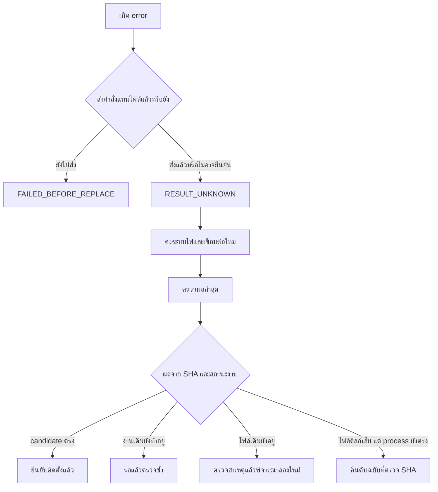

# การตรวจไฟล์และการกู้สถานะเมื่อเกิด error

## ก่อนเขียนรถ

โปรแกรมยืนยัน SHA ของ Launcher ต้นฉบับ อ่าน resource 3,076 รายการ แล้วแก้เฉพาะ allowlist ของส่วนที่เลือก หลังแพ็กกลับ ตรวจ metadata, ขนาด PNG, resource ที่ไม่เลือก และ bytes นอกพื้นที่ภาพ/offset ตารางที่ต้องเปลี่ยนให้คงเดิม สีตัวเลข/วงรอบเครื่องต้องรักษา alpha และพิกเซลเขตรอบสูงสีแดง

ชุดส่วนตัวอยู่ภายนอก Git repository ภาพ preview ใช้ resource จากสำเนาของผู้ใช้ ส่วน candidate สร้างจาก Launcher ที่ตรวจ fingerprint ไม่ใช้ภาพ preview เป็นหลักฐานแทนการตรวจ binary

## ระหว่างติดตั้ง

1. ตรวจสถาปัตยกรรม, พื้นที่ว่าง, PID และ SHA ของไฟล์บนดิสก์/ไฟล์ process
2. สำรอง Launcher ปัจจุบันและตรวจ SHA สำเนา ต้นฉบับต้องตรง fingerprint ที่รองรับ
3. ส่งแพตช์และตรวจ SHA แต่ละไฟล์
4. เตรียม candidate ในชื่อชั่วคราวบน filesystem เดียวกับ Launcher
5. ตรวจ SHA ทั้งไฟล์ candidate และตรวจ precondition อีกครั้งก่อนแทนไฟล์
6. ใช้ commit lock ป้องกันงานซ้อน และ atomic rename เพื่อแทนชื่อไฟล์
7. อ่าน SHA กลับ ตรวจ process เดิมและ boot partition จากนั้นบันทึกผล

ไม่มีการสั่งหยุด Launcher หรือ reboot รถโดยโปรแกรม หลังสำเร็จผู้ใช้ใช้การปิด–เปิดระบบไฟตามปกติ

## การขาดการเชื่อมต่อไม่บอกว่าการเขียนสำเร็จหรือไม่

เมื่อรับ `RESULT_UNKNOWN` โปรแกรมไม่ส่งคำสั่งติดตั้งซ้ำ ปุ่ม **ตรวจผลล่าสุด / งานที่ค้าง** อ่าน SHA/สถานะฝั่งรถก่อน หาก candidate ตรงและไม่มีงานเดิมทำอยู่จะรายงานว่าเขียนสำเร็จ หากดิสก์ต่างจาก process ต้องพิจารณาผลตรวจนี้ก่อนปิด–เปิด

ถ้า process เดิมยังเป็นชุดที่รู้จัก สามารถคืนดิสก์จากสำเนาต้นฉบับที่ตรง SHA ได้ แม้ดิสก์ไม่ตรงชุดที่รองรับ แต่ถ้า process ไม่รู้จัก, สำเนาไม่ตรง, หรืองานเดิมยังทำงานอยู่ จะปฏิเสธการคืนค่า

## Lock และรายงาน

- commit lock: `/data/codex368k-studio/commit.lock/owner` เก็บ PID/รหัสงาน/boot ID
- สถานะงานบนรถ: `/data/codex368k-studio/<รหัสงาน>/status.txt`
- log งานบนรถ: `/data/codex368k-studio/<รหัสงาน>/install.log`
- สำเนาก่อนงานนั้น: `/data/codex368k-studio/<รหัสงาน>/Launcher.previous`
- สำเนาต้นฉบับ: `/data/codex368k-studio/Launcher.stock`
- รายงานบนคอม: `Documents\368K Studio\exports\device-<รหัสงาน>.json`
- job/session/log ของ public edition: `%LOCALAPPDATA%\368KStudio-public`

ปุ่ม **ปลดล็อกงานค้าง** จะทำได้เฉพาะเมื่อตรวจ owner ที่ระบุได้ และยืนยันว่า process เจ้าของไม่อยู่แล้วหรือเป็น boot เก่า ก่อนลบ metadata จะตรวจ owner ซ้ำ ปุ่มนี้ไม่คืน Launcher และไม่ใช่ปุ่มแก้ทุก error

Job journal เขียนลงไฟล์ชั่วคราว flush/fsync แล้ว atomic replace งานที่ค้างเมื่อโปรแกรมเปิดใหม่กลายเป็น `interrupted` หาก project JSON อ่านไม่ได้ จะเก็บไฟล์เสียในชื่อใหม่และเปิดค่าเริ่มต้น ไม่ทับหลักฐานเดิม

## ข้อจำกัดที่ยังมี

Atomic rename/สำรอง/hash checks ลดความเสี่ยง แต่รับประกันการกู้จากระบบไฟตกหรืออุปกรณ์บันทึกเสียไม่ได้ ถ้าจอไม่บูตหรือ Telnet เข้าไม่ได้ ต้องกู้ด้วยวิธีฮาร์ดแวร์และสำเนาต้นฉบับ ปุ่มในโปรแกรมไม่สามารถ hard reset หรือแก้ระบบล็อกคอรถ

Telnet ไม่เข้ารหัสและใช้สิทธิ์ root ตามบริการเดิมของรถ ให้ใช้ผ่าน Wi-Fi รถของตนเอง โปรแกรมไม่ปรับระบบความปลอดภัยเครือข่ายของรถ

การตรวจ source/binary และ mock transport เป็นหลักฐานของเงื่อนไขในโปรแกรม ไม่ยืนยันพฤติกรรมอุปกรณ์ทุก firmware ภาพสีใหม่และรุ่น public ที่ใช้สำเนาภายนอกต้องตรวจบนรถที่รองรับ ขณะจอด หลังการติดตั้งที่ตรวจผ่าน

## แนบข้อมูลเมื่อรายงานปัญหา

ระบุรุ่นโปรแกรม, SHA ของ Launcher, ขั้นตอนที่ทำ, ข้อความ error และสถานะงาน ส่งเฉพาะส่วนของรายงานที่เกี่ยวข้อง ลบ URL ที่มี token, session, ชื่อ/เส้นทางส่วนตัว และรูปส่วนตัวก่อนเปิด issue สาธารณะ ไม่แนบ Launcher, boot image หรือโปรเจกต์ที่มีภาพส่วนตัวลง issue
